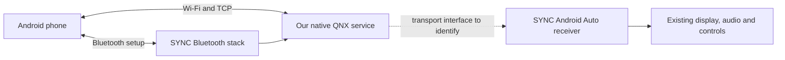

# Native wireless Android Auto investigation

Investigation opened October 30, 2026. Native feasibility on Mortis remains unverified.

**Initial result:** [Experiment 002](../experiments/002-stock-image-inspection.md) extracted the matching stock application image and identified `MM_GalService`, `Transport`/`UsbTransport` vtables, imported AOA bulk functions, Wi-Fi P2P code and Bluetooth SPP exports. We now have concrete receiver and radio API targets. These have not been exercised on Mortis.

## Architecture to test

The useful starting point is preserving SYNC's working Android Auto display, audio and controls while replacing the phone's USB data connection. The stock receiver's AOA imports and transport vtables provide candidate interfaces; their suitability for a network adapter is an engineering hypothesis.

The two largest uncertainties are access to the existing radio stacks and the receiver's transport interface. Wi-Fi frequency support alone answers neither.

## What the reference code establishes

The following are observations of reference implementations, not measurements of SYNC:

| Boundary | Source observation | Consequence for our implementation |
| --- | --- | --- |
| Bluetooth discovery | `bluetoothHandler.cpp` registers Android Auto Wireless UUID `4de17a00-52cb-11e6-bdf4-0800200c9a66` as a server profile; its BlueZ configuration selects RFCOMM channel 8. It also implements a BLE advertisement. | Investigate service registration and RFCOMM access in the installed SYNC stack. Neither BlueZ nor channel 8 should be assumed on QNX. |
| Session setup | `bluetoothProfiles.cpp` sends a protobuf `WifiStartRequest` containing host IP and TCP port, receives `WifiInfoRequest`, and sends `WifiInfoResponse`. | Implement the actual setup protocol rather than treating a generic Bluetooth connection as sufficient. |
| Network credentials | `WifiInfoResponse.proto` carries SSID, key, BSSID, security mode and access-point type. | The reference path supplies a head-unit access point. Check whether the installed driver and firmware can provide it. |
| Data forwarding | `proxyHandler.cpp` accepts TCP and forwards Android Auto frames to/from `/dev/usb_accessory`; TCP-to-USB forwarding reconstructs complete frames, including extended headers for first fragments. | A native transport adapter must preserve protocol framing and lifecycle. A TCP socket alone does not attach it to SYNC's receiver. |
| Reconnection | `aa-proxy-rs` has explicit handshake retry and restart paths, including `quick_reconnect`. | Repeated delivery stops require session cleanup and restart logic, not just startup at ignition. |

Primary sources, inspected October 30:

- [WirelessAndroidAutoDongle Bluetooth stack integration](https://github.com/nisargjhaveri/WirelessAndroidAutoDongle/blob/main/aa_wireless_dongle/package/aawg/src/bluetoothHandler.cpp), Git blob `9aa1bc5f717dd5762282a53e5694ddb0b6e9bbba`.
- [Bluetooth setup and framing](https://github.com/nisargjhaveri/WirelessAndroidAutoDongle/blob/main/aa_wireless_dongle/package/aawg/src/bluetoothProfiles.cpp), Git blob `e6f5c6e23aba3d13bb36f85d04630886c642d292`.
- [Wi-Fi response schema](https://github.com/nisargjhaveri/WirelessAndroidAutoDongle/blob/main/aa_wireless_dongle/package/aawg/src/proto/WifiInfoResponse.proto).
- [TCP/USB forwarding](https://github.com/nisargjhaveri/WirelessAndroidAutoDongle/blob/main/aa_wireless_dongle/package/aawg/src/proxyHandler.cpp), Git blob `9511ffd52d69031e19fec44552573a5a181466f6`.
- [aa-proxy-rs Bluetooth setup and restart handling](https://github.com/aa-proxy/aa-proxy-rs/blob/main/src/bluetooth.rs), Git blob `f937c5016485ce13abffdd6c316ff27164993d24`.

The C++ reference is MIT licensed; `aa-proxy-rs` is GPL-2.0. This investigation has not copied implementation code into Mortis. Local reference captures are ignored under `private/research/`.

Bluetooth call routing, media audio and wireless setup must be measured separately. The Rust implementation sometimes disconnects its bootstrap Bluetooth connection to allow calls through the real head unit; other modes retain it. That is bridge behavior, not evidence that Mortis must disable Bluetooth audio or use a second radio. Record the owner's reported autoconnect behavior during a stock wired baseline before proposing changes to pairing or profile settings.

## Native access and development path

The [SYNC Quake II port](https://github.com/bigunclemax/ford_s3_quake_mod) demonstrates third-party native execution on some SYNC 3 installations. Its [generated build file](https://github.com/bigunclemax/ford_s3_quake/blob/master/Ports/Quake2/Premake/Build-Linux/gmake/quake2-gles2.make) uses a `CROSS_COMPILE` compiler prefix and ARM/QNX defines. It does not supply a verified SDK/toolchain for Mortis. Match architecture, loader, C/C++ ABI and shared-library versions from the actual image before building a diagnostic binary.

The [FMods FAQ](https://www.fmods.net/community/faqpage) describes a custom package installation path involving a jailbreak, installer daemon and tools. Its [linked jailbreak instructions](https://www.fmods.net/community/viewtopic.php?t=190) require a forum login, so their exact procedure and compatibility have not been reviewed. No FMods package has been downloaded or installed. This is one candidate execution path; it is not a prerequisite for offline reverse engineering or the only possible way to run original code.

The stock package `4U5T-14G381-AN`, listed as **3.3.19052**, was downloaded from Ford and verified against its published MD5. Its extracted version metadata matches the owner's display; its installation on Mortis still needs confirmation from inventory DID `8033`. [Experiment 002](../experiments/002-stock-image-inspection.md) records hashes, extraction, ELF evidence and the next reverse-engineering targets.

## First native experiment

Question: **Can we identify the actual Android Auto receiver process and its transport boundary without replacing the receiver?**

1. Inspect the matching stock package offline for boot image metadata, ELF headers, loaded modules, receiver binaries, Bluetooth stack and Wi-Fi drivers. Record files, hashes, symbols and configuration evidence; filenames alone are only leads.
2. Use Experiment 001's inventory to confirm the application and hardware. Establish a compatible execution method and recovery path before any persistent access modification.
3. Once a shell or diagnostic runner is available, collect `uname -a`, `pidin info`, `pidin ar`, `ifconfig -a` and loaded-library information for the relevant processes into private captures. Use process names learned from the image rather than guessing them.
4. Compare idle, stock wired Android Auto connected, and disconnected states. For receiver candidates, inspect `pidin -p PROCESS fds` and `pidin -p PROCESS mapinfo` to identify changed USB resources, IPC endpoints and shared libraries. These are QNX inspection commands, not Linux `/proc` assumptions.
5. Look for an existing network transport or a replaceable USB I/O interface. Record the call/data path before designing a shim. If no usable boundary exists, assess receiver changes or an original receiver with explicit audio/video/input integration.

The [QNX `pidin` reference](https://www.qnx.com/developers/docs/6.5.0SP1.update/com.qnx.doc.neutrino_utilities/p/pidin.html) documents process arguments, file descriptors and memory maps. Availability and permissions on Mortis are unknown. The commands above have not been run there.

A successful first result names the receiver executable, its loaded libraries and a transport interface backed by evidence. An inaccessible interface is a result to investigate, not proof that native implementation is impossible.

## Radio experiment after access

Identify the driver and interface before querying supported modes. [QNX `ifconfig`](https://www.qnx.com/developers/docs/6.5.0SP1.update/com.qnx.doc.neutrino_utilities/i/ifconfig.html) documents `list caps` and channel queries for compatible wireless drivers; [QNX `hostapd`](https://www.qnx.com/developers/docs/6.5.0SP1.update/com.qnx.doc.neutrino_utilities/h/hostapd.html) documents the authenticator and required driver support. These establish available QNX mechanisms, not that Ford shipped or enabled them.

A separate small test should establish a temporary authenticated AP and verify that the phone can reach a QNX TCP listener, then restore the original network state. Pair that with a Bluetooth service-registration test. Do not replace the running radio stack merely to find out its capabilities.

## Eventual acceptance checks

Test automatic startup, maps, media, navigation prompts, microphone, calls, touch and steering-wheel input. Measure Bluetooth reconnect to first usable frame. Include short stops where SYNC remains awake, stops long enough for sleep, ignition cycles, loss of Wi-Fi, phone reboot and connection loss mid-session. Start with 20 repeated return-to-van cycles, recording failures, recovery time and any required taps. This is a proposed initial test count, not a claimed reliability guarantee.
